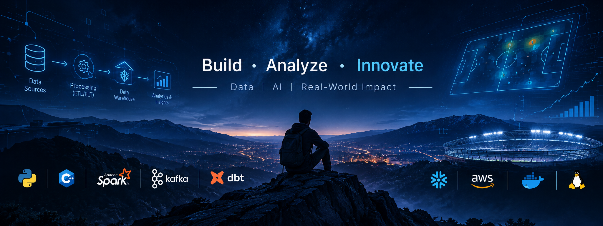
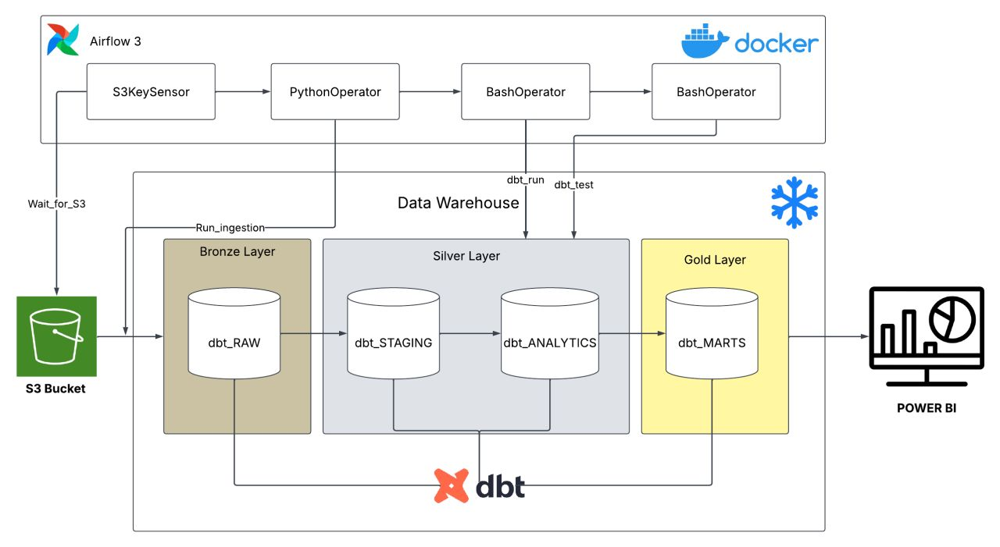

# Yassir Lagnaoui

### Big Data & AI Engineering Student
**Data Engineering · Machine Learning · Applied AI**

Building data systems and intelligent applications, from batch and streaming pipelines to predictive models.

---

## 👨‍💻 About Me

I'm an engineering student at **ENSA Tétouan**, specializing in **Big Data & Artificial Intelligence**, with graduation expected in 2027.

I enjoy designing and building practical solutions that turn raw data into useful insights.

My interests cover:

- **Data Engineering:** Batch and streaming pipelines, ELT, orchestration and data modeling.
- **Machine Learning:** Predictive modeling, feature engineering and model evaluation.
- **Applied AI:** Deep learning, computer vision and intelligent applications.
- **Engineering Practices:** Python development, Docker, Git workflows and Linux.

Currently looking for a **2027 PFE internship** where I can contribute to data and AI projects while continuing to grow as a versatile engineer.

---

## 🛠️ Tech Stack

**Programming Languages**

**Data Engineering & Cloud**

**AI, DevOps & Tools**

## 🚀 Featured Projects

<table>
<tr>
<td width="50%" valign="top">

### 🛒 Olist E-Commerce ELT Pipeline

**AWS S3 · Snowflake · dbt · Airflow · Docker · Python · SQL**

An end-to-end data engineering project built around the Olist Brazilian e-commerce dataset.

- Raw data ingestion and cloud storage.
- Snowflake as the cloud data warehouse.
- dbt transformations and analytical data modeling.
- Airflow workflow orchestration.
- Docker-based environment.
- Power BI dashboard for data analysis.

[**📂 Explore Repository →**](https://github.com/CRlNBOUCH/olist_db_pipeline)

</td>
<td width="50%" valign="top">

### ⚽ Real-Time Football Telemetry Pipeline

**Kafka · Python · PostgreSQL · Docker · Power BI**

A real-time data pipeline designed to ingest and monitor football player telemetry.

- Event production and consumption using separate components.
- Apache Kafka for streaming data.
- Python-based event processing.
- PostgreSQL for data persistence.
- Docker Compose for containerized deployment.
- Power BI for real-time performance monitoring.

[**📂 Explore Repository →**](https://github.com/CRlNBOUCH/Real_time_football_pipeline)

</td>
</tr>

<tr>
<td width="50%" valign="top">

### 📈 Expected Goals (xG) Model

**Python · Machine Learning · StatsBomb**

A football analytics project focused on estimating the probability of a shot resulting in a goal.

- StatsBomb event data collection.
- Shot data exploration and preparation.
- Expected-goals model implementation.
- Visual exploration of football shooting patterns.

[**📂 Explore Repository →**](https://github.com/CRlNBOUCH/xG_model)

</td>
<td width="50%" valign="top">

### 🔭 What's Next?

Continuously exploring new technologies and engineering concepts.

Interested in building scalable data platforms, distributed systems and practical AI applications.

More projects coming soon!

</td>
</tr>
</table>

---

## 💼 Experience

### AI Engineering Intern — Centrale Danone
*July – August 2026 | Morocco*

Worked on daily sales forecasting for dairy products across 100 store-product series.

- Built and compared XGBoost and LightGBM forecasting models.
- Reached 87% forecast accuracy.
- Reduced forecast error by 33% compared with a naive baseline.
- Added P90 forecasts to support safety-stock planning.

The project used a simulated dataset because the company's real data was confidential.

---

## 📜 Certifications

- **Snowflake:** Modern Data Engineering; Developer / Data Engineer courses.
- **IBM:** Python Project for Data Engineering; Python for Data Science, AI & Development.
- **Stanford / DeepLearning.AI:** Advanced Learning Algorithms.
- **Oracle:** Cloud Infrastructure Foundations.
- **Google:** Introduction to Git and GitHub.

---

## 📊 GitHub Statistics

---

### Dream it. Build it. Deploy it.

*Always learning, building, and improving.*

